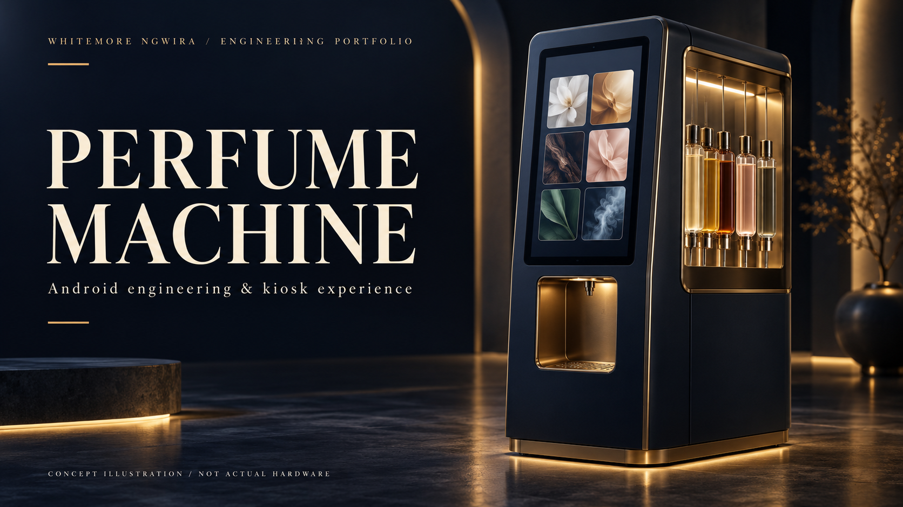
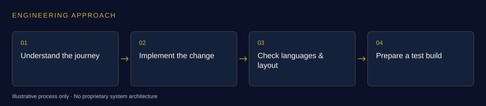

# Perfume Machine

### Android engineering & kiosk experience

**Whitemore Ngwira · Sweet Robo · Selected engineering contributions**

*AI-generated concept illustration. The equipment and interface shown are fictional; they are not photographs or screenshots of Sweet Robo products.*

## At a glance

I contributed Android application improvements for perfume-dispensing kiosks during my work at Sweet Robo, covering multilingual customer journeys, operator configuration and test-build validation.

**Focus:** Android application engineering  
**Skills demonstrated:** Android · Kotlin · Localisation · Kiosk UX · Regression testing

## The engineering challenge

A physical kiosk has to communicate clearly in several languages while remaining practical for operators. Small interface changes can affect text layout, machine configuration and the path from selection to dispensing.

## My contribution

### Multilingual customer journeys

I integrated and corrected language resources, checked variable placeholders and reviewed customer-facing text across the kiosk journey.

### Interface behaviour

I adjusted layouts to accommodate additional language choices and verified representative screens on an isolated Android emulator.

### Operator configuration

I implemented a clearer configuration flow with confirmation before consequential changes, preserving the surrounding application behaviour.

### Test-build preparation

I ran automated regression checks, built test APKs and documented the difference between emulator evidence and checks that require a physical machine.

## How I approached the work

*Illustrative engineering workflow; not the product's internal design.*

1. Understand the journey.
2. Implement the change.
3. Check languages & layout.
4. Prepare a test build.

## What the work produced

The work produced reviewable application changes, test builds and documented checks for multilingual and operator-facing flows.

This is a contribution summary. It does not claim that every change has been released or that emulator checks establish physical dispensing acceptance.

## Public review boundary

This is a documentation-only portfolio showcase. Private source code, internal platform names, infrastructure, endpoints, schemas, credentials, customer information, operational records and internal screenshots are excluded. Supporting work records remain private.

The narrative explains my contribution within a team-owned product. The concept artwork is not evidence of implementation or an employer-approved product design.

## Explore the series

- [Vending Machine](https://github.com/whitemorengwira/sweet-robo-vending-machine)
- [Photo Booth](https://github.com/whitemorengwira/sweet-robo-photo-booth)
- [Control Centre Engineering](https://github.com/whitemorengwira/sweet-robo-control-centre-engineering)

## Contact

[GitHub profile](https://github.com/whitemorengwira) · [N.White Systems](https://nwhite.systems/) · [Email Whitemore](mailto:hello@nwhite.systems)

I can discuss my engineering approach and responsibilities within the applicable confidentiality boundaries.

See [Portfolio viewing notice](COPYRIGHT.md).

